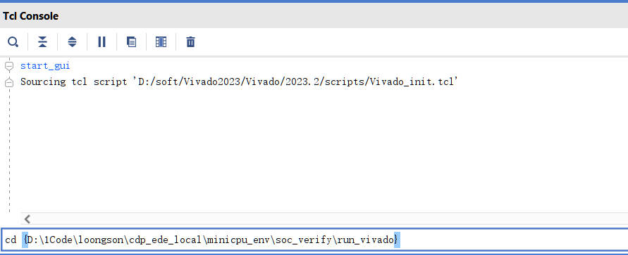
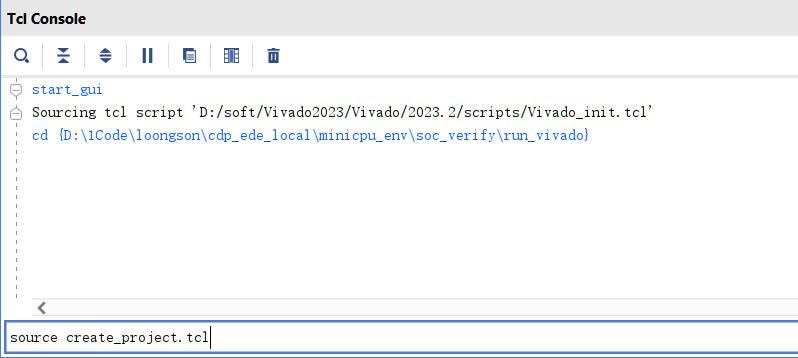
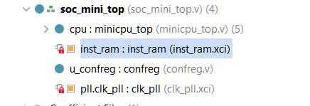
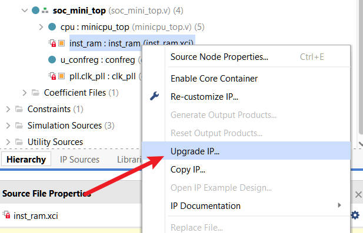
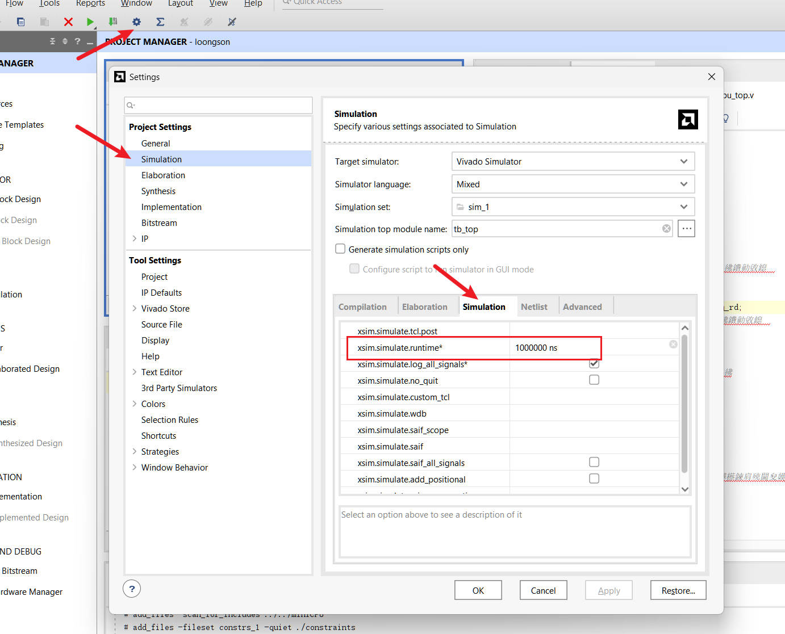

# Lab 5: Single-Cycle CPU with Five Instructions

!!! info "Reference in the Book"

    [*CPU Design in Practice: LoongArch Edition* 4.1 Verifying a Single-Cycle CPU with 5 Instructions / 4.3.1 Practical Task 5](https://bookdown.org/loongson/_book3/chapter-single-cycle-cpu.html#sec-verify-5insts-single-cycle-cpu)

## Objectives

- Understand the datapath of a single-cycle CPU: instruction fetch → decode → execute → memory access → write back, all completed within one cycle.
- Become familiar with the organization and workflow of the lab environment (minicpu_env).
- Be able to simulate and run on the board a single-cycle CPU supporting 5 instructions, and to run a simple test program.

## Environment

The directory structure of the whole **minicpu_env** lab environment, together with a brief description of what each part does, is shown below:
```
|--miniCPU/             RTL code of the CPU you implement
|  |--minicpu_top.v     Top-level module of the 5-instruction single-cycle CPU
|  |--regfile.v         Register file module in the CPU
|  |--tools.v           Basic functional modules in the CPU
|
|--func/                Functional verification test programs
|  |--inst_ram.coe      Binary pure-data file of the test program, used when running on the board
|  |--inst_ram.mif      Binary pure-data file of the test program, used for functional simulation
|  |--inst_ram.txt      Assembly code description of the test program
|
|--soc_verify/          Verification environment for the CPU you implement
   |--rtl/              Directory of the SoC design code used for verification
   |  |--soc_mini_top.v Top-level file of the SoC
   |  |--CONFREG/       The confreg module, used to access board peripherals such as the LEDs and the DIP switches
   |  |--xilinx_ip/     Customized Xilinx IP, including clk_pll and inst_ram
   |
   |--testbench/        Functional simulation verification platform
   |
   |--run_vivado/       The run directory of the Vivado project
      |--constraints/   Design constraints for the Vivado project
```
From this point on, **you do not need to create the Vivado project by hand — we provide a script in the lab environment that creates it for you!** The `soc_verify/run_vivado/create_project.tcl` script creates the Vivado project in one step!

1.Open Vivado, and in the Tcl Console at the bottom first enter the **miniCPU/soc_verify/run_vivado** directory.


!!! note
    In Linux paths the separator is `/`, while in Windows paths it is `\`. Vivado's TCL only accepts the Linux form, so be sure to remember to wrap paths in braces `{}` under Windows!

2.Use the `source` command to run the `create_project.tcl` script and wait for the Vivado project to be created; the project file is `loongson.xpr` under the `minicpu_env/soc_verify/run_vivado/project/` directory.
```
source create_project.tcl
```


3.Once the project has been created, be sure to check that the project `Top` is set correctly, that the simulation time is long enough, and whether the IP cores need a version upgrade.

!!! tips "How to upgrade the IP cores"
    After you create the project, you will see a red lock symbol next to the IP cores. This means that the Vivado version that created the current IP cores is older than the one you are using. Right-click and click upgrade IP to upgrade the IP cores.

     

??? tips "Simulation length"
    When the simulation in Vivado stops after running for only 1000ns, increase the simulation time of the Vivado project as shown in the figure below. You can switch to units such as `ms` and `s`!

    


## Tasks
Read and understand the code provided in the lab environment, and **complete the missing parts of the code** so that the design passes simulation and board verification.


## Steps

1. Open the miniCPU project in the `minicpu_env/soc_verify/run_vivado/` directory.
2. Re-customize `inst_ram` in the miniCPU project and select the coe file from the corresponding func directory (`minicpu_env/func/`inst_ram`.coe`).
3. Run the simulation of the miniCPU project (once the simulation window is open, just click run all) and start debugging. You can modify the switch value in the `minicpu_tb.v` file in the `minicpu_env/soc_verify/testbench/` directory to check whether the led output matches what you expect (you must re-run the simulation after every change to the switch value). (The test program for this lab is a Fibonacci program: the Fibonacci sequence is 0, 1, 1, 2, 3, 5, …, and from the third term onward every term equals the sum of the two terms before it. **The third term of the sequence is taken to be f(1), that is, f(1)=1, f(2)=2, f(3)=3, f(4)=5, … .** Changing the DIP switch value is equivalent to changing n, and the led output gives f(n).)
4. Once the myCPU simulation passes, synthesize and implement the design, generate the bitstream, and verify it on the board.

## Acceptance Criteria

- [ ] The simulation passes with the given test program, and the led output matches the correct value of the Fibonacci program.
- [ ] After running on the board, changing the DIP switch value shows the correct Fibonacci result on the leds.
