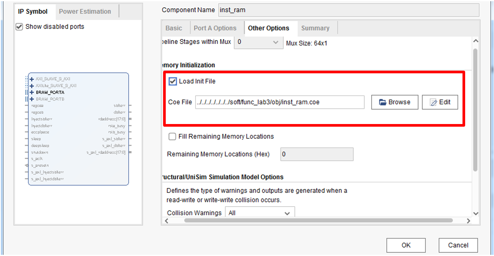

# Lab 6: Single-Cycle CPU with Twenty Instructions

!!! info "Reference in the Book"

    [*CPU Design in Practice: LoongArch Edition* 4.2 Verifying a Single-Cycle CPU with 20 Instructions / 4.3.2 Practical Task 6](https://bookdown.org/loongson/_book3/chapter-single-cycle-cpu.html)

## Objectives

- Extend the single-cycle CPU from five instructions to 20, covering a complete subset of arithmetic, logic, shift, comparison, branch, and memory access instructions.
- Master the organization and workflow of the mycpu_env lab environment.
- Learn to use an automated debugging method **based on trace comparison**, and use the func functional test programs to verify that your CPU is correct.


## Environment
From here on we will use the `mycpu_env` environment, and all the later labs take place in that folder. You do not have to master all of this right away — just pick up new material as the labs progress. The parts of the `mycpu_env` directory that are not listed here are irrelevant to the current practical tasks and will be introduced in the corresponding later labs.

The upgraded lab environment lives in the top-level subdirectory mycpu_env, and its directory structure together with a brief description of each part is shown below:
```
|--gettrace/                The part that generates the reference trace.
|  |--src/                  Design source directory.
|  |  |--tb_top.v           Simulation top level; this module captures debug information into golden_trace.txt.
|  |  |--soc_lite_top.v     Top-level file of SoC_Lite.
|  |  |--refCPU/            The reference processor core design that produces the comparison trace.
|  |  |--CONFREG/           The confreg module, used to access the CPU and board peripherals such as the seven-segment display and the DIP switches.
|  |  |--BRIDGE/            A 1×2 bridge module: the CPU's data sram interface accesses confreg and data_ram at the same time.
|  |--gettrace.xpr          Vivado project file.
|  |--golden_trace.txt      The reference trace generated by running the func test program. You must generate it yourself.
|
|--func/                    Functional verification test programs used by the lab tasks.
|  |--include/              Directory holding the header files shared by the functional verification test programs.
|  |  |--sysdep.h           Header file holding some macro definitions common to GCC.
|  |  |--asm.h              Header file holding some macro definitions needed by LoongArch assembly, such as LEAF(x).
|  |  |--regdef.h           Assembly mnemonic definitions of the 32 general-purpose registers under the LoongArch32 ABI.
|  |  |--cpu_cde.h          Macro definitions of SoC_Lite-related parameters, such as the base address of the confreg that accesses the seven-segment display.
|  |  |--inst_test.h        Header file of macro definitions used by the verification programs for each functional test point
|  |--inst/                 Assembly program files for each functional test point.
|  |  |--Makefile           The Makefile in this subdirectory, which is invoked by the Makefile in the parent directory.
|  |  |--n*.S               Verification programs for each functional test point, written in assembly.
|  |--obj/                  Directory holding the compiled functional verification test programs
|  |  |--*                  See the description in a later section.
|  |--start.S               Boot code and main function of the functional verification test.
|  |--Makefile              Makefile script that compiles the functional verification test programs
|  |--bin.lds               The result of compiling bin.lds.S; it can be removed with the make reset command
|  |--convert.c             C source code of the tool that generates the coe and mif files
|
|--myCPU/                   The RTL code of your own CPU.
|
|--soc_verify/              The SoC system verification environment for your own CPU
   |--soc_dram/             The verification environment for when the CPU's external interface connects to distributed RAM.
   |  |--rtl/               SoC_Lite design source directory.
   |  |  |--soc_lite_top.v  Top-level file of SoC_Lite.
   |  |  |--CONFREG/        The confreg module, used to access the CPU and board peripherals such as the seven-segment display and the DIP switches.
   |  |  |--BRIDGE/         A 1×2 bridge module: the CPU's data sram interface accesses confreg and data_ram at the same time.
   |  |  |--xilinx_ip/      Customized Xilinx IP, including clk_pll, inst_ram, and data_ram.
   |  |--testbench/         Functional simulation verification platform.
   |  |  |--mycpu_tb.v      Functional simulation top level; this module captures debug information and compares it against golden_trace.txt.
   |  |--run_vivado/        The run directory of the Vivado project.
   |     |--constraints/    Design constraints for the Vivado project.
   |     |--mycpu_dram_prj/ Directory holding the Vivado project files.
```
In Lab 6 we only need the `mycpu_env/soc_verify/soc_dram` directory! The project-creation script is also in the corresponding `run_vivado` folder, and it is used in the same way as in Lab 5, so we will not repeat that here.

## Tasks

We have already provided a single-cycle CPU supporting five instructions. Please **extend that CPU to implement the following 20 instructions:**

- Arithmetic: **add.w, sub.w, addi.w**
- Comparison: **slt, sltu**
- Logic: **nor, and, or, xor**
- Shift: **slli.w, srli.w, srai.w**
- Memory access: **ld.w, st.w**
- Branch and jump: **jirl, b, bl, beq, bne**
- Other: **lu12i.w**

!!! info "Select EXP6 as the test program"

## Steps
The configuration of this lab environment is rather involved, so work through it carefully. The other three environments under `soc_verify` are configured in the same way.

1. Open WSL2 and go to a Linux shell, then enter the `mycpu_env\func` directory and run `make EXP=6`; the 6 here selects the test program for Lab 6.
2. Open the `gettrace` project — `mycpu_env/gettrace/gettrace.xpr`. (The IP cores in this Vivado project were created with Vivado 2019.2; if you open it with a newer version of Vivado, upgrade the IP cores as described in `Lab 5 environment section`.) Run the `gettrace` project's simulation (once the simulation window is open, just click run all and wait for the simulation to finish) to generate a new reference trace file `golden_trace.txt` (`mycpu_env/gettrace/golden_trace.txt`). The simulation has to run to completion before `golden_trace.txt` holds its complete contents, so check by hand that `golden_trace.txt` is not empty.
3. Go into the `mycpu_env/soc_verify/soc_dram/run_vivado/` directory and start the project that verifies myCPU. If no project has been created in that directory yet, use the `create_project.tcl` script there to create one.
4. Re-customize the `inst_ram` IP in the project.
5. Run the simulation in the myCPU verification project (once the simulation window is open, just click run all), and verify and debug the design until the simulation test passes (**a passing simulation test prints PASS!, while a failure prints the PC of the first instruction where your design differs from the reference core**).
6. Synthesize and implement the design in the myCPU verification project, generate the bitstream, and verify it on the board.

??? tips "Accessing Windows folders from WSL2"
    Just prefix the path with `/mnt/`, and note that you must use the `/` separator!
    ```
    # Go to your user directory on the C: drive
    cd /mnt/c/Users/<your-username>

    # Go to the Desktop
    cd /mnt/c/Users/<your-username>/Desktop

    # Go to a project folder on the D: drive
    cd /mnt/d/projects/myapp
    ```

??? tips "Re-customizing `inst_ram`"
    Whenever we update the func program and recompile it, we need to re-customize `inst_ram` so that it picks up the latest contents of the func/obj/ directory.

    Note that only the projects under soc_verify need `inst_ram` re-customized; for the project under gettrace, the INST_COE macro in soc_lite_top.v points directly at the mif file in the func/obj/ directory. The procedure for re-customizing `inst_ram` is as follows:

    In the Sources window, find the `inst_ram` IP, then double-click it or right-click and choose "Re-customize IP…" to open the customization view.
    In the re-customize IP dialog that appears (shown in Figure 4.7), select the Other Options tab, tick Load Init File, and under Coe File click "Browse" to select the newly generated `inst_ram.coe`, then click OK.
    In the Generate Output Product window that appears, click Generate (choose global or ooc mode as needed) to finish re-customizing `inst_ram`.
    

??? tip "golden_trace and difftest"
    At the moment we take a correct core, run the same test program on it and generate a `golden_trace.txt` file, then compare that against our own core; if the two match exactly, we can consider that our core ran the corresponding test program correctly.

    However, using golden_trace to verify core correctness is no longer widely used; these days core correctness is more often verified by **differential testing (Difftest)**. Students who are interested can read the XiangShan processor's official documentation for a detailed introduction to [DiffTest](https://docs.xiangshan.cc/zh-cn/latest/tools/difftest/)

## Hints
- Refer to the [LoongArch32R Reduced Instruction Set Manual](https://www.loongson.cn/uploads/images/2023041918122813624.%E9%BE%99%E8%8A%AF%E6%9E%B6%E6%9E%8432%E4%BD%8D%E7%B2%BE%E7%AE%80%E7%89%88%E5%8F%82%E8%80%83%E6%89%8B%E5%86%8C_r1p03.pdf) to implement the instructions the lab requires.
- Pay attention to signal bit widths, and avoid bizarre bugs caused by signals being truncated!!!

## Acceptance Criteria

- [ ] The Lab 6 test program passes simulation in full, and the simulation prints PASS;
- [ ] After running on the board, both LEDs are green and the seven-segment display shows `1400 0014`;

!!! info "How to tell a correct board run"
    When verifying on the FPGA there is only one way to judge whether the result is correct. The correct behavior of the test program is:

    1.At the start, all the monochrome LEDs are off, the bicolor LEDs show one red and one green, and the seven-segment display shows all zeros;

    2.During execution, all the monochrome LEDs are off, the bicolor LEDs show one red and one green, and the high and low 8 digits of the seven-segment display count up together;

    3.At the end, all the monochrome LEDs are off, both bicolor LEDs are green, and the high and low 8 digits of the seven-segment display hold the same value, corresponding to the number of functional test points — for example: 3A 00 00 3A.

    If an error occurs while the test program is running, the first point at which the high and low 8 digits of the seven-segment display differ is the number of the functional test point that failed, and the final state is: all the monochrome LEDs lit, both bicolor LEDs red, and the high and low 8 digits of the seven-segment display holding different values.

    In addition, you can adjust the execution speed of the program by changing the DIP switch value, so that you can see the seven-segment display count up in full.


